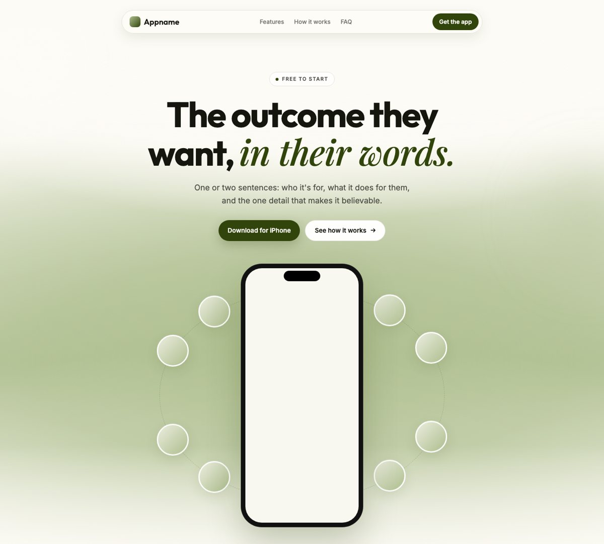
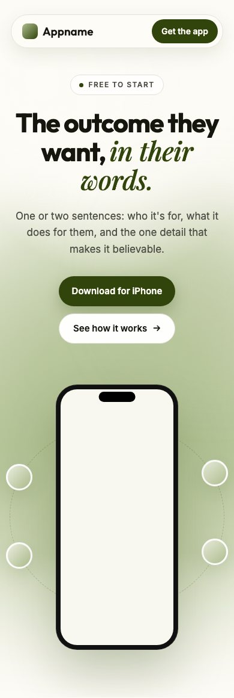

# Barek Landing

An agent skill for [Claude Code](https://claude.com/claude-code) (and any agent
that reads `SKILL.md` skills) that builds a calm, premium landing page for an
app or product. It's the style behind Barek's own app sites: a centred floating
pill nav, a soft layered gradient glow behind one phone, a heavy headline with
one italic serif phrase, pill buttons or an email waitlist, and the app's art
orbiting the device.

<p align="center">
  
  &nbsp;
  
</p>

The template above runs on four colour tokens. Change them and the glow,
cards, borders and shadows all follow.

## What's inside

| File | Purpose |
| --- | --- |
| `SKILL.md` | The design thinking (why one phone, why centred, why one accent) and the workflow: read the product, set tokens, write copy, build, verify |
| `template/index.html`, `template/styles.css` | A working page: nav, hero with glow and orbit, features, steps, FAQ, final CTA, footer, waitlist variant |
| `references/techniques.md` | How each piece works: the gradient layers, orbit math, line and scroll reveals, nav, colour derivation |
| `scripts/contrast.mjs` | WCAG check for the four tokens on the pairs the page actually uses |
| `scripts/preview.sh` | Desktop and true 390px phone screenshots with headless Chrome, and fails on sideways overflow |

## Install

With npm (Node 18+), from your project folder:

```bash
npx github:Barek-Technologies/barek-landing                       # this project: ./.claude/skills/
npx github:Barek-Technologies/barek-landing --global              # every project: ~/.claude/skills/
npx github:Barek-Technologies/barek-landing --dir .agents/skills  # any other agent's skills folder
```

Run the same command again to update.

Or with the [skills CLI](https://www.npmjs.com/package/skills), or plain git:

```bash
npx skills add Barek-Technologies/barek-landing
git clone https://github.com/Barek-Technologies/barek-landing ~/.claude/skills/barek-landing
```

Then ask: *"Build a landing page for my app"*, *"Make a waitlist page"*, *"Our
site is too busy, redo it"*, or run `/barek-landing`.

## Use the template by hand

```bash
cp -r template my-site && open my-site/index.html
```

Edit the four tokens at the top of `styles.css`:

```css
--accent: #aebe8e;   /* the glow */
--brand:  #31440c;   /* buttons, links, the italic phrase */
--bg:     #fdfbf6;   /* warm off-white */
--ink:    #15170f;   /* headings */
```

Check them, then preview:

```bash
node scripts/contrast.mjs --accent "#aebe8e" --brand "#31440c" --bg "#fdfbf6" --ink "#15170f"
scripts/preview.sh my-site/index.html preview/
```

Plain HTML and CSS, no build step. It ports to Next.js, Astro or Expo web as-is.
It needs a browser with `color-mix()` (Safari 16.2+, Chrome 111+, Firefox 113+).

## The rules it follows

- One phone with one real screen, never a collage.
- Everything on the centre line; one accent colour family.
- One italic serif phrase per heading, at the end.
- Motion is slow, optional, and off under reduced motion; the page works without JavaScript.
- No invented proof: waitlist counts, logos and ratings only when they're real.

## More Barek skills

| Skill | What it does |
| --- | --- |
| [barek-competitor-watch](https://github.com/Barek-Technologies/barek-competitor-watch) | Competitor study and review mining → what to build next |
| [barek-aso](https://github.com/Barek-Technologies/barek-aso) | Store name, subtitle, keywords and descriptions, researched against what ranks |
| [appstore-screenshots](https://github.com/Barek-Technologies/appstore-screenshots) | Highest-converting screens, captioned and rendered at exact store sizes |
| [barek-landing](https://github.com/Barek-Technologies/barek-landing) | This one: the landing page |

## License

MIT © 2026 Barek Technologies Limited. See [LICENSE](LICENSE).
